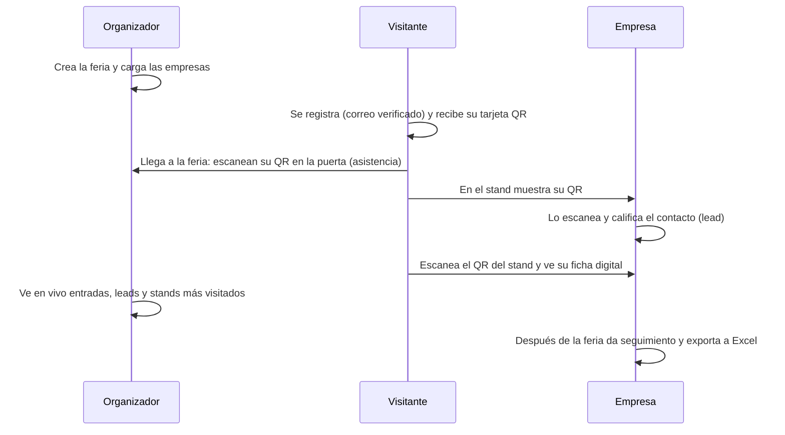
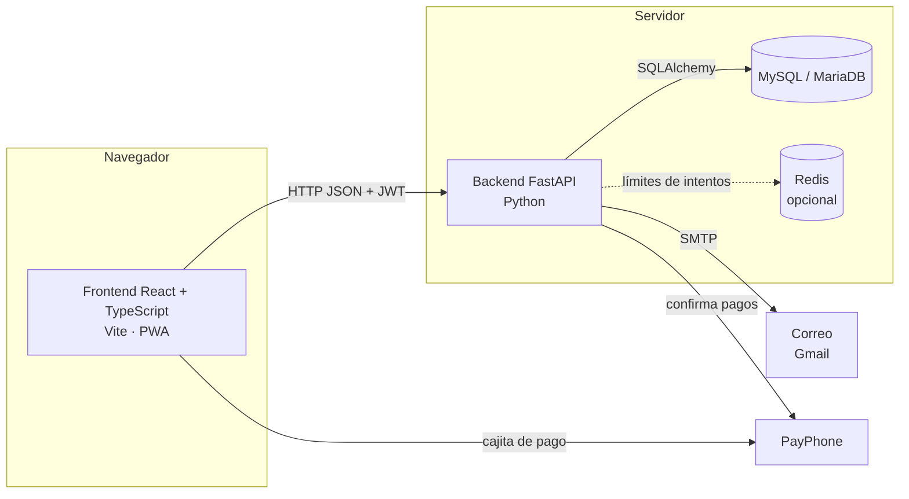

# FeriaBot Pro

**Plataforma web para organizar ferias comerciales con códigos QR.** Los visitantes reciben una tarjeta digital con
QR, las empresas escanean esa tarjeta en su stand para guardar el contacto (lead) y el organizador ve en tiempo real
cuántas personas entraron, qué stands visitaron y cuántos contactos se generaron. FeriaBot Pro se vende a los
organizadores por planes (Básico, Profesional y Premium), con pago por transferencia o con tarjeta.

> Proyecto desarrollado en Ecuador (moneda USD, RUC, Ley Orgánica de Protección de Datos Personales — LOPDP).

---

## Índice

1. [Qué problema resuelve](#qué-problema-resuelve)
2. [Roles](#roles)
3. [Funcionalidades](#funcionalidades)
4. [Cómo funciona una feria](#cómo-funciona-una-feria)
5. [Planes y contratación](#planes-y-contratación)
6. [Arquitectura](#arquitectura)
7. [Tecnologías](#tecnologías)
8. [Estructura del repositorio](#estructura-del-repositorio)
9. [Instalación en desarrollo](#instalación-en-desarrollo)
10. [Cuentas y datos de prueba](#cuentas-y-datos-de-prueba)
11. [Configuración (.env)](#configuración-env)
12. [Seguridad y protección de datos](#seguridad-y-protección-de-datos)
13. [Pruebas](#pruebas)
14. [Publicación en producción](#publicación-en-producción)
15. [Equipo y forma de trabajo](#equipo-y-forma-de-trabajo)
16. [Más documentación](#más-documentación)

---

## Qué problema resuelve

En una feria tradicional los contactos se pierden en tarjetas de papel, hojas sueltas o fotos del celular. Las
empresas no saben a quién llamar después, el visitante no recuerda qué stands visitó y el organizador no tiene cifras
para demostrar el valor de la feria a sus patrocinadores.

FeriaBot Pro digitaliza ese recorrido:

| Antes | Con FeriaBot Pro |
| --- | --- |
| Registro en papel en la entrada | Registro web con correo verificado y tarjeta QR personal |
| Tarjetas de presentación | La empresa escanea el QR del visitante y califica el contacto |
| Folletos impresos | Ficha digital de cada stand (servicios, fotos, contacto) que se abre con un QR |
| Conteos a mano | Control de acceso en la puerta y estadísticas en vivo |
| Excel armado después | Leads ordenados por estado y exportables a Excel |

---

## Roles

| Rol | Quién es | Cómo entra |
| --- | --- | --- |
| **Super Administrador** | El equipo de FeriaBot Pro (dueño de la plataforma) | `/ingresar?rol=superadmin` con correo y contraseña |
| **Organizador** | El cliente que contrata un plan y organiza ferias | `/ingresar` → pestaña Organizador |
| **Empresa** | Cada expositor de una feria (y sus vendedores) | `/ingresar` → pestaña Empresa |
| **Visitante** | El público que asiste | Con el código de su tarjeta (`FB-XXXXXX`) o con su correo y un código de verificación |

Cada organizador ve y modifica **solo sus ferias**, con sus empresas, visitantes y leads. Las de otro organizador
responden como si no existieran.

---

## Funcionalidades

### Super Administrador (`/admin`)
- **Resumen**: organizadores por estado y plan, ingreso mensual estimado, ferias activas, empresas, inscripciones y
  cuentas por vencer.
- **Solicitudes**: planes contratados desde la web. Las transferencias se revisan (comprobante) y se aprueban o
  rechazan; los pagos con tarjeta se aprueban solos.
- **Organizadores**: crear, editar (ficha con RUC), asignar plan y vigencia, renovar, suspender o reactivar, y ver
  su uso frente a los límites del plan.
- **Ferias** y **Visitantes**: ver y corregir las ferias de cualquier organizador, sus participantes y todos los
  visitantes de la plataforma.
- **Planes**: precios mensual y anual, límites, descripción y visibilidad en la página principal; datos bancarios
  para transferencias.
- **Equipo**: otras personas con acceso de Super Administrador.
- **Registros**: actividad del equipo (quién hizo qué y cuándo) y constancias de aceptación de la política de
  privacidad.

### Organizador (`/organizador`)
- Selector de feria y **resumen** con gráficos (inscritos por día, escaneos por hora, ranking de empresas, ciudades).
- **Ferias**: crear, editar, duplicar, portada, aforo, abrir o cerrar inscripciones, enlace y cartel QR de registro,
  recordatorio por correo a los inscritos.
- **Empresas**: alta manual o **importación desde Excel**, RUC, stand, contraseña de acceso y cartel QR del stand.
- **Visitantes**: listado paginado con búsqueda, registro en la entrada, tarjeta imprimible, CSV.
- **Acceso**: control de entrada escaneando la tarjeta del visitante.
- **Leads**: todos los contactos de la feria con filtros, cambio de estado y exportación a Excel.
- **Perfil**: datos de acceso y **su plan** (vigencia, límites y uso). Aviso cuando el plan vence o se llena.

### Empresa (`/empresa`)
- **Escanear**: lee el QR del visitante y guarda el lead con una calificación (interesado, visita, correo, no
  interesado) y una nota.
- **Mis leads**: contactos con estado de seguimiento (nuevo, contactado, cotizado, cerrado), CSV y Excel.
- **Mi ficha**: logo, descripción, servicios, fotos y contacto; es lo que ve el visitante al escanear el stand.
- **Mi equipo**: vendedores con su propio acceso.

### Visitante (`/visitante`)
- **Mi tarjeta**: QR personal para cada feria en la que está inscrito, descargable como imagen y disponible sin
  conexión (PWA).
- **Ferias**: ferias en curso y próximas, historial con los contactos de cada una e inscripción a otras ferias.
- **Escanear stand**: abre la ficha digital de la empresa y la guarda en su historial.
- **Mi cuenta**: editar datos, cambiar correo (con código) o borrar la cuenta.

### Público (sin sesión)
- Página principal con el flujo de cada rol y la **sección de planes** con precios.
- Listado y detalle de ferias, registro de visitante, ficha pública de cada empresa.
- **Contratar** un plan en 3 pasos (datos → pago → comenzar) con recibo.
- Páginas legales: privacidad, tratamiento de datos, aviso legal y cookies.

---

## Cómo funciona una feria



**Dos tipos de QR**
- **Tarjeta del visitante**: `FERIABOT:V:<código>` (por ejemplo `FERIABOT:V:FB-7K3PQX`). La escanean la empresa y la
  puerta.
- **Stand de la empresa**: `https://<dominio>/ficha/<empresaId>`. Cualquier cámara de celular lo abre.

Una sola cuenta de visitante sirve para varias ferias, con el mismo código.

---

## Planes y contratación

| Plan | Ferias en curso o próximas a la vez | Empresas por feria | Visitantes por feria |
| --- | --- | --- | --- |
| Básico | 2 | 200 | 1.000 |
| Profesional | 5 | 200 | 5.000 |
| Premium | 20 | 400 | 10.000 |

- Los valores son los iniciales: el Super Administrador cambia precios y límites desde su panel.
- Las ferias finalizadas no cuentan para el límite.
- Con el plan **vencido** el organizador ve sus datos pero no crea ferias, empresas ni inscripciones. Con la cuenta
  **suspendida** no puede ingresar.

**Contratar desde la web** (`/#planes` → `/contratar`):

| Forma de pago | Cómo funciona | Quién activa la cuenta |
| --- | --- | --- |
| **Tarjeta** (PayPhone, Cajita de Pagos) | El cliente paga dentro de la página; el backend confirma el pago con PayPhone | El sistema, automáticamente |
| **Transferencia** | El cliente ve los datos bancarios y sube el comprobante | Un encargado del equipo, desde *Solicitudes* |

Al activarse, se crea la cuenta del organizador con el plan por 1 mes o 1 año y le llega su acceso por correo. Sin
credenciales de PayPhone, la tarjeta aparece como «Próximamente»; en desarrollo existe un **modo demostración**
(`PAYPHONE_DEMO=true`) que simula el pago sin cobrar.

---

## Arquitectura



- El **frontend** es una aplicación de una sola página (SPA) instalable en el celular (PWA). Toda la comunicación con
  el servidor está en `frontend/src/services/api.ts`.
- El **backend** expone una API REST en JSON. La sesión viaja como **JWT** en la cabecera `Authorization`.
- La **base de datos** se crea y actualiza sola al arrancar (`backend/app/migraciones.py`), sin herramientas extra.
- Los **correos** (códigos, bienvenida con QR, accesos, recordatorios, avisos de pago) salen por SMTP. Sin
  configurarlo, se muestran en la consola del backend.

---

## Tecnologías

| Capa | Tecnología |
| --- | --- |
| Backend | **Python 3.13** + **FastAPI**, Uvicorn, Pydantic 2, SQLAlchemy 2, PyMySQL |
| Seguridad | bcrypt (contraseñas), JWT HS256 (sesiones), HMAC-SHA256 (códigos), AES-256-GCM (datos sensibles) |
| Otros del backend | openpyxl (Excel), qrcode (QR en correos), email-validator |
| Frontend | **React 18** + **TypeScript** + **Vite** |
| Librerías del frontend | React Router, Recharts (gráficos), html5-qrcode (escáner), qrcode.react, lucide-react (íconos), vite-plugin-pwa |
| Base de datos | **MySQL / MariaDB** (XAMPP en desarrollo) |
| Pagos | PayPhone (Cajita de Pagos) y transferencia bancaria |
| Opcional | Redis (límites de intentos compartidos), Umami o Plausible (analítica sin cookies) |

---

## Estructura del repositorio

```
Feria-Bot-Pro/
├── README.md                ← este archivo
├── backend/                 API FastAPI
│   ├── app/
│   │   ├── main.py          arranque, middlewares, manejo de errores
│   │   ├── config.py        variables de entorno
│   │   ├── models.py        tablas (SQLAlchemy)
│   │   ├── schemas.py       validación de datos (Pydantic)
│   │   ├── migraciones.py   cambios de la base al arrancar
│   │   ├── routers/         endpoints: auth, admin, solicitudes, ferias, empresas, visitantes, leads, vistas…
│   │   ├── planes.py        planes, límites y vigencia
│   │   ├── payphone.py      pago con tarjeta
│   │   ├── cifrado.py       AES-256-GCM
│   │   ├── limites.py       anti fuerza bruta y límites por IP (Redis opcional)
│   │   ├── registros.py     actividad del equipo y aceptaciones de la política
│   │   ├── correo.py        correos y plantillas
│   │   ├── seed.py          datos de demostración
│   │   ├── datos_prueba.py  carga masiva de datos de prueba
│   │   └── crear_superadmin.py  crear el Super Administrador en producción
│   ├── requirements.txt
│   ├── .env.example
│   └── README.md            detalle técnico: endpoints, variables, correos, seguridad
└── frontend/                SPA React
    ├── src/
    │   ├── pages/           pantallas por rol (admin, organizador, empresa, visitante) y públicas
    │   ├── components/      piezas reutilizables (tablas, checkout, cajita de pago…)
    │   ├── context/         sesión, feria elegida, avisos y confirmaciones
    │   ├── services/api.ts  todas las llamadas al backend
    │   ├── lib/             utilidades, validaciones, paginación, planes
    │   └── types.ts         tipos compartidos
    ├── .env.example
    └── README.md
```

---

## Instalación en desarrollo

### Requisitos
- **Python 3.11 o superior** (probado con 3.13)
- **Node.js 18 o superior** y npm
- **XAMPP** (MySQL/MariaDB) u otro servidor MySQL
- Git

### 1. Base de datos
1. Abre XAMPP y enciende **MySQL**.
2. Crea la base vacía (desde phpMyAdmin o la consola):
   ```sql
   CREATE DATABASE feriabot CHARACTER SET utf8mb4 COLLATE utf8mb4_unicode_ci;
   ```
3. Recomendado: en `C:\xampp\mysql\bin\my.ini`, sección `[mysqld]`, cambia `max_allowed_packet=1M` por
   `max_allowed_packet=16M` y reinicia MySQL (para portadas y comprobantes de más de 1 MB).

### 2. Backend
```powershell
cd backend
py -m venv .venv
.\.venv\Scripts\python -m pip install -r requirements.txt
copy .env.example .env
```
Edita `backend/.env`. Como mínimo:
```ini
DATABASE_URL=mysql+pymysql://root:@localhost:3306/feriabot?charset=utf8mb4
JWT_SECRET=<genera una: py -c "import secrets; print(secrets.token_urlsafe(48))">
CLAVE_CIFRADO=<genera una: py -c "import base64, os; print(base64.urlsafe_b64encode(os.urandom(32)).decode())">
```
Arranca la API (las tablas se crean solas):
```powershell
.\.venv\Scripts\python -m uvicorn app.main:app --reload --port 8000
```
Documentación interactiva de la API: **http://localhost:8000/docs**

### 3. Frontend
```powershell
cd frontend
npm install
copy .env.example .env
npm run dev
```
Abre **http://localhost:5173**. Con `VITE_API_URL=/api` el frontend llega al backend por el proxy de Vite.

> La cámara del navegador (escáner de QR) solo funciona en `localhost` o con HTTPS.

---

## Cuentas y datos de prueba

**Solo en desarrollo** (`ENTORNO=desarrollo`, el valor por defecto), al arrancar se crean si no existen:

| Rol | Correo | Contraseña |
| --- | --- | --- |
| Super Administrador | `superadmin@feriabot.com` | `superadmin123` |
| Organizador | `admin@feriabot.com` | `admin123` |

> En producción **no** se crean estas cuentas: ver [Publicación en producción](#publicación-en-producción).

**Datos de prueba masivos** (no tocan tus datos; todo lleva el prefijo `pr-` y correos `@example.com`):
```powershell
cd backend
.\.venv\Scripts\python -m app.datos_prueba              # 8 ferias, 57 empresas, 300 visitantes, leads y vistas
.\.venv\Scripts\python -m app.datos_prueba --organizadores  # 5 organizadores de ejemplo (uno por plan y estado)
.\.venv\Scripts\python -m app.datos_prueba --reset      # borrar y volver a cargar
.\.venv\Scripts\python -m app.datos_prueba --borrar     # quitar solo lo de prueba
```
Accesos de los datos de prueba: empresas `<empresa>.<feria>@example.com` / `empresa123`, vendedores
`vendedor1.<empresa>.<feria>@example.com` / `vendedor123`, organizadores de ejemplo `<clave>@example.com` /
`organizador123`. El script muestra al final el código de un visitante con historial.

---

## Configuración (.env)

### Backend (`backend/.env`)

| Variable | Para qué |
| --- | --- |
| `DATABASE_URL` | Conexión a MySQL |
| `ENTORNO` | `desarrollo` o `produccion` |
| `JWT_SECRET` | Firma de las sesiones (larga y aleatoria) |
| `CLAVE_CIFRADO` | Clave AES-256-GCM para teléfonos, comprobantes e IP. **Respáldala** |
| `SMTP_HOST` · `SMTP_PORT` · `SMTP_USER` · `SMTP_PASSWORD` | Envío de correos (Gmail con contraseña de aplicación) |
| `FRONTEND_URL` | Dirección pública del frontend (enlaces en correos, sitemap) |
| `CORS_ORIGINS` | Orígenes que pueden llamar a la API |
| `FORZAR_HTTPS` | Redirección a HTTPS y HSTS en producción |
| `LIMITES_ACTIVOS` · `REDIS_URL` | Anti fuerza bruta; Redis opcional |
| `PAYPHONE_TOKEN` · `PAYPHONE_STORE_ID` · `PAYPHONE_DEMO` | Pago con tarjeta y modo demostración |
| `SUPERADMIN_*` · `ADMIN_*` | Cuentas iniciales (ver arriba) |
| `RESPONSABLE_*` | Datos del responsable en los textos legales |

La lista completa con valores por defecto está en [`backend/README.md`](backend/README.md#variables-de-entorno).

### Frontend (`frontend/.env`)

| Variable | Para qué |
| --- | --- |
| `VITE_API_URL` | Dirección del backend (`/api` usa el proxy de Vite) |
| `VITE_SITE_URL` | Dominio público (URL canónica y redes sociales) |
| `VITE_ANALITICA` · `VITE_ANALITICA_ID` | Analítica sin cookies (Umami o Plausible) |

> Los archivos `.env` **no se suben** al repositorio (están en `.gitignore`). Solo se suben los `.env.example`.

---

## Seguridad y protección de datos

| Protección | Implementación |
| --- | --- |
| Contraseñas | **bcrypt** con sal; mínimo 8 caracteres con letras y números |
| Datos sensibles | **AES-256-GCM** para teléfonos, comprobantes de pago e IP (cifrado transparente al guardar y leer) |
| Códigos por correo | **HMAC-SHA256**, vencen a los 10 minutos y admiten 5 intentos |
| Sesiones | **JWT HS256** con vencimiento |
| Inyección SQL | SQLAlchemy con parámetros; ningún dato del usuario se concatena en SQL |
| XSS | React escapa todo; el backend solo acepta enlaces `http(s)` e imágenes JPG, PNG o WebP |
| Fuerza bruta | Bloqueo de la cuenta 15 minutos tras 5 contraseñas incorrectas, límites por IP y límite general de 300 peticiones por minuto (Redis opcional) |
| Spam | Campo trampa (honeypot) en formularios públicos |
| Validación | Todo dato se valida también en el backend (Pydantic), con mensajes en español |
| Transporte | HTTPS con HSTS en producción y cabeceras de seguridad (CSP, X-Frame-Options, etc.) |
| Pagos | Los datos de la tarjeta los captura PayPhone; nunca pasan por el servidor de FeriaBot Pro |

**LOPDP (Ecuador)**
- Política de privacidad y de tratamiento de datos versionadas; el visitante las acepta al registrarse.
- **Constancia de cada aceptación**: fecha, versión, origen (web, entrada de la feria o contratación) e IP.
- **Registro de actividad** del equipo cuando consulta datos personales o hace cambios.
- El visitante puede editar o borrar su cuenta, y cambiar su correo con verificación.

---

## Pruebas

- **Frontend**: `npm run build` revisa los tipos (TypeScript) y compila.
- **Backend**: la API se probó con scripts que recorren cada flujo (ingresos, permisos entre organizadores, límites de
  planes, solicitudes, pagos con un PayPhone simulado, cifrado, bloqueo de cuentas, inyección SQL y XSS) contra una
  copia de la base de datos.
- **Documentación interactiva**: http://localhost:8000/docs permite probar cada endpoint desde el navegador.

---

## Publicación en producción

Lista de verificación:

1. **Servidor**: backend con Uvicorn detrás de un proxy (Render, Railway, VPS con nginx) y frontend compilado
   (`npm run build`, carpeta `dist`) en un hosting estático (Vercel, Netlify) o en el mismo servidor.
2. **`.env` del servidor** (nunca copies el de tu computadora):
   ```ini
   ENTORNO=produccion
   FORZAR_HTTPS=true
   JWT_SECRET=<nueva>
   CLAVE_CIFRADO=<nueva, y respáldala>
   FRONTEND_URL=https://tu-dominio.com
   CORS_ORIGINS=["https://tu-dominio.com"]
   ```
   Con `ENTORNO=produccion` el backend no arranca si `JWT_SECRET` o `CLAVE_CIFRADO` faltan o son débiles.
3. **Primer Super Administrador**: en la carpeta `backend` del servidor:
   ```bash
   py -m app.crear_superadmin
   ```
   Pide correo, nombre y contraseña sin guardarlos en ningún archivo. Con el mismo correo sirve para cambiar la
   contraseña; `--listar` muestra quiénes tienen acceso.
4. **Correo**: configura `SMTP_*` (Gmail con contraseña de aplicación u otro proveedor).
5. **Pagos**: cuenta en Payphone Business, aplicación WEB en Payphone Developer con tu dominio y como URL de respuesta
   `https://tu-dominio.com/contratar/resultado`; luego `PAYPHONE_TOKEN` y `PAYPHONE_STORE_ID`. Nunca actives
   `PAYPHONE_DEMO` en producción.
6. **Datos bancarios y precios**: complétalos desde el panel del Super Administrador (*Planes*).
7. **Redis** (si hay varios procesos o servidores): `REDIS_URL` y `pip install redis`.
8. **Buscadores**: reenvía `/robots.txt` y `/sitemap.xml` a la API y registra el sitemap en Google Search Console.
9. **MySQL**: `max_allowed_packet` de al menos 16 MB y copias de seguridad periódicas de la base **y** de
   `CLAVE_CIFRADO`.

Detalle técnico en [`backend/README.md`](backend/README.md#publicación).

---

## Equipo y forma de trabajo

| Integrante | Área |
| --- | --- |
| [@Jkennedy2004](https://github.com/Jkennedy2004) | Backend (FastAPI, base de datos, seguridad, pagos) |
| [@odaliasengell](https://github.com/odaliasengell) | Frontend (React, diseño e interfaces) |

**Git**
- Se trabaja en la rama `main`, sin ramas de funcionalidades ni pull requests.
- Antes de subir: `git pull`; luego `git commit` y `git push`.
- Mensajes de commit en español con prefijo: `feat(back):`, `feat(front):`, `fix:`, `docs:`, `refactor:`.

---

## Más documentación

- [`backend/README.md`](backend/README.md): puesta en marcha detallada, todas las variables, endpoints, correos,
  seguridad, Super Administrador, planes y pagos.
- [`frontend/README.md`](frontend/README.md): estructura del frontend, rutas y configuración.
- API interactiva: `http://localhost:8000/docs` con el backend encendido.
